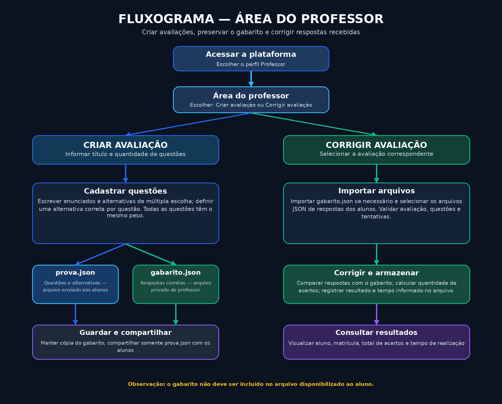
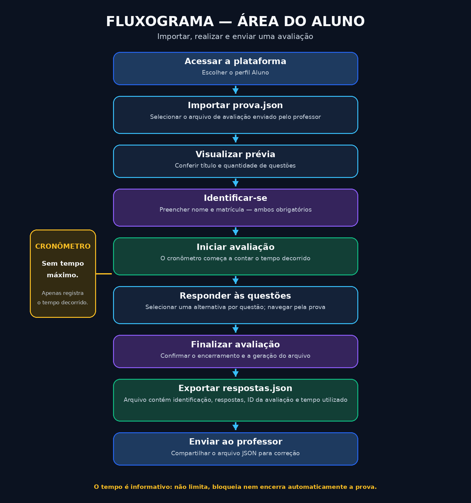

# >_ Plataforma de Avaliações Acadêmicas

> Um MVP web para criação, aplicação e correção de avaliações acadêmicas.


---

## > Sobre o projeto

A **Plataforma de Avaliações Acadêmicas** é um projeto de extensão que propõe uma aplicação web simples para auxiliar professores na criação e correção de provas e alunos na realização dessas avaliações.

O sistema possui dois ambientes principais:

- **Professor:** responsável por criar avaliações, cadastrar questões, definir o gabarito, exportar a prova e corrigir as respostas dos alunos.
- **Aluno:** responsável por importar a avaliação, informar seus dados, responder às questões e exportar suas respostas para envio ao professor.

Este projeto está sendo desenvolvido como um **MVP (Minimum Viable Product — Produto Mínimo Viável)**. Isso significa que sua primeira versão terá apenas as funcionalidades essenciais para validar a ideia e demonstrar o funcionamento do sistema.

O objetivo é construir uma solução funcional, simples e organizada, que possa ser aprimorada futuramente.

## > Objetivos do projeto

- Facilitar a criação de avaliações acadêmicas.
- Simplificar o compartilhamento de provas entre professores e alunos.
- Automatizar a correção de questões objetivas.
- Registrar os resultados das avaliações.
- Validar o sistema com testadores reais (professores e alunos) e documentar os resultados.
- Desenvolver uma aplicação web utilizando tecnologias fundamentais do desenvolvimento frontend.
- Construir uma base que permita futuras evoluções do sistema.

---

## > Situação atual das funcionalidades

Legenda: ✅ implementado | 🔧 planejado (fase de melhorias para testadores)

### Área do professor

| Funcionalidade | Situação |
|---|---|
| Acesso protegido por senha simples (sessão do navegador) | ✅ |
| Botão "Voltar ao início" na área do professor e na tela de acesso | ✅ |
| Criar avaliação com título, quantidade de questões (1 a 50) e formato | ✅ |
| Formatos de questão: múltipla escolha (2 a 5 alternativas) ou verdadeiro/falso | ✅ |
| Cadastrar enunciados e alternativas | ✅ |
| Editar avaliações já cadastradas | ✅ |
| Definir e editar o gabarito (uma alternativa correta por questão) | ✅ |
| Exportar a prova em JSON (sem gabarito) | ✅ |
| Excluir avaliação (remove também o gabarito) | ✅ |
| Importar o arquivo de respostas de um aluno e corrigir automaticamente | ✅ |
| Validar o arquivo importado e bloquear tentativa duplicada | ✅ |
| Armazenar os resultados localmente | ✅ |
| Consultar resultados por avaliação (acertos, erros, em branco, nota) e correção individual por questão | ✅ |
| Exibir o tempo de realização na tabela de resultados | 🔧 |
| Exportar o gabarito em arquivo JSON (backup) | 🔧 |
| Importar o gabarito a partir de arquivo JSON | 🔧 |

> O tempo de realização já é recebido no arquivo do aluno e armazenado junto com o resultado, mas ainda não é exibido na tela de resultados.

### Área do aluno

| Funcionalidade | Situação |
|---|---|
| Botão de voltar na área do aluno e na tela de identificação | ✅ |
| Importar a avaliação por arquivo JSON, com validação da estrutura e mensagem de confirmação | ✅ |
| Informar nome e matrícula (obrigatórios) | ✅ |
| Responder questão a questão, navegando entre anterior e próxima | ✅ |
| Cronômetro de tempo decorrido, sem limite máximo | ✅ |
| Finalizar a avaliação e exportar o arquivo `respostas.json` | ✅ |
| Tela de conclusão após finalizar, com opção de baixar o `respostas.json` novamente | ✅ |
| Aviso ao tentar sair ou recarregar a prova sem finalizar | 🔧 |
| Recuperar respostas, questão atual e tempo caso a página seja recarregada | ✅ |
| Revisão das questões não respondidas, com confirmação antes de finalizar | 🔧 |
| Mensagens exibidas na própria página no lugar de `alert()` | 🔧 |
| Resumo das respostas antes de exportar o arquivo | 🔧 |

### > Regra do cronômetro

O professor **não define um tempo máximo para a avaliação**.

O cronômetro possui apenas a função de registrar quanto tempo o aluno levou para realizar a prova.

- Começa a contar quando o aluno confirma nome e matrícula e inicia a avaliação.
- Permanece ativo durante a realização.
- Se a página for recarregada, continua a partir do início original da prova (o tempo em que a página ficou fechada também é contado).
- Não possui limite máximo.
- Não encerra a prova automaticamente.
- Para ao finalizar, e o tempo utilizado (em segundos) é registrado no arquivo JSON exportado.

---

## > Fluxo do sistema

### Fluxograma do professor

O professor pode criar uma nova avaliação ou corrigir uma avaliação já realizada.



### Fluxograma do aluno

O aluno importa a avaliação, informa seus dados, realiza a prova e exporta suas respostas.



---

## > Estrutura dos arquivos JSON

A comunicação entre professor e aluno é realizada por meio de arquivos JSON.

O sistema utiliza três tipos principais de arquivos.

> **Sobre os identificadores:** os exemplos abaixo usam `AV001` e `Q001` por legibilidade. Os identificadores gerados pelo sistema têm outro formato: avaliações recebem `AV-<timestamp>` (ex.: `AV-1731090000000`), questões recebem `Q1`, `Q2`, `Q3`... e tentativas recebem `ATT-<timestamp>`. O sistema aceita qualquer identificador de texto, desde que seja coerente entre prova, gabarito e respostas.

### 1. prova.json

Arquivo exportado pelo professor e disponibilizado aos alunos.

Contém:
- Identificador da avaliação.
- Título da avaliação.
- Questões, com enunciados e alternativas disponíveis.

**Importante:** o arquivo da prova não contém o gabarito.

Exemplo:

```json
{
  "tipo": "avaliacao",
  "versao": 1,
  "id": "AV001",
  "titulo": "Avaliação de exemplo",
  "questoes": [
    {
      "id": "Q001",
      "enunciado": "Qual alternativa está correta?",
      "alternativas": [
        { "id": "A", "texto": "Alternativa A" },
        { "id": "B", "texto": "Alternativa B" },
        { "id": "C", "texto": "Alternativa C" }
      ]
    }
  ]
}
```

Um arquivo de prova pronto para testes está disponível em `prova-teste.json`.

### 2. gabarito.json

Arquivo privado do professor, contendo as respostas corretas de cada questão.

Nesta versão, o gabarito é salvo no LocalStorage do navegador do professor e utilizado na correção automática. A exportação e a importação do gabarito em arquivo estão **planejadas** (ver tabela de funcionalidades). O formato previsto é:

```json
{
  "tipo": "gabarito",
  "versao": 1,
  "avaliacaoId": "AV001",
  "respostas": [
    {
      "questaoId": "Q001",
      "alternativaCorreta": "B"
    }
  ]
}
```

Enquanto a exportação não estiver disponível, os dados do gabarito ficam vinculados ao navegador. Se os dados do navegador forem apagados ou a correção for feita em outro dispositivo, será necessário cadastrar o gabarito novamente.

### 3. respostas.json

Arquivo gerado pelo aluno ao finalizar a avaliação.

Contém:
- Identificador da avaliação.
- Identificador da tentativa.
- Nome e matrícula do aluno.
- Respostas selecionadas (`null` quando a questão não foi respondida).
- Tempo utilizado, em segundos.
- Data de realização, em formato ISO 8601 (UTC).

Exemplo:

```json
{
  "tipo": "respostas",
  "versao": 1,
  "avaliacaoId": "AV001",
  "tentativaId": "ATT-1731090600000",
  "aluno": {
    "nome": "Nome do aluno",
    "matricula": "2026001"
  },
  "respostas": [
    {
      "questaoId": "Q001",
      "alternativaSelecionada": "B"
    },
    {
      "questaoId": "Q002",
      "alternativaSelecionada": null
    }
  ],
  "tempoUtilizado": 532,
  "dataRealizacao": "2026-11-08T17:30:00.000Z"
}
```

O arquivo não contém o gabarito nem informações sobre a correção.

---

## > Regras de negócio

1. As questões são objetivas: múltipla escolha (2 a 5 alternativas) ou verdadeiro/falso (2 alternativas).
2. Cada questão tem uma única alternativa correta.
3. Todas as questões têm o mesmo peso.
4. O resultado principal é a quantidade de acertos. O sistema também apresenta erros, questões em branco e a nota calculada pelo módulo de correção.
5. Questões não respondidas são consideradas como não acertadas.
6. Nome e matrícula são obrigatórios para iniciar a avaliação.
7. O cronômetro registra o tempo decorrido, sem limite máximo.
8. O gabarito é armazenado separadamente da avaliação disponibilizada aos alunos.
9. A correção verifica se o arquivo de respostas corresponde à avaliação selecionada, se todas as questões e alternativas existem e se não há respostas duplicadas.
10. O sistema valida os arquivos JSON importados (prova pelo aluno e respostas pelo professor).
11. O sistema impede importar duas vezes a mesma tentativa (mesmo `tentativaId`).
12. A correção só é realizada se a avaliação possuir gabarito completo e válido.
13. 🔧 *(planejada)* Ao finalizar com questões em branco, o aluno deverá ser informado e confirmar antes de gerar o arquivo.
14. A prova em andamento é mantida na sessão do navegador: ao recarregar a página, respostas, questão atual e cronômetro são recuperados. Ao finalizar, a prova é encerrada e não pode ser retomada; apenas o arquivo `respostas.json` pode ser baixado novamente na tela de conclusão.

---

## > Tecnologias utilizadas

| Tecnologia | Aplicação |
|---|---|
| HTML5 | Estrutura das páginas |
| CSS3 | Estilização e responsividade |
| JavaScript ES6+ | Lógica e funcionalidades |
| LocalStorage | Armazenamento dos dados do professor (avaliações, gabaritos e resultados) |
| SessionStorage | Dados temporários da sessão (avaliação em andamento, respostas, tempo e acesso do professor) |
| JSON | Importação e exportação de informações |

Nesta primeira versão, não são utilizados frameworks, backend ou banco de dados.

---

## > Estrutura do projeto

Estrutura dos arquivos em uso pelas páginas atuais:

```text
plataforma-avaliacoes-academicas/
│
├── index.html
├── README.md
├── prova-teste.json
│
├── src/
│   ├── pages/
│   │   ├── acesso-professor.html
│   │   ├── professor.html
│   │   ├── criar-avaliacao.html
│   │   ├── cadastrar-questoes.html
│   │   ├── corrigir-avaliacao.html      (definição do gabarito)
│   │   ├── importar-respostas.html
│   │   ├── resultados.html
│   │   ├── aluno.html
│   │   ├── realizar-avaliacao.html
│   │   └── avaliacao-finalizada.html
│   │
│   ├── css/
│   │   ├── professor.css
│   │   └── aluno.css
│   │
│   └── js/
│       ├── professor/
│       │   ├── acesso.js
│       │   ├── proteger-acesso.js
│       │   ├── sair.js
│       │   ├── avaliacao.js
│       │   ├── questoes.js
│       │   ├── listar-avaliacoes.js
│       │   ├── gabarito.js
│       │   ├── importar-respostas.js
│       │   └── resultados.js
│       │
│       ├── aluno/
│       │   ├── importar-avaliacao.js
│       │   ├── identificacao.js
│       │   ├── prova.js
│       │   ├── cronometro.js
│       │   ├── exportar-respostas.js
│       │   └── finalizada.js
│       │
│       └── services/
│           └── correcao.js
│
└── docs/
    ├── images/
    │   ├── fluxograma-professor.png
    │   └── fluxograma-aluno.png
    └── testes.md
```

Documentos adicionais previstos em `docs/` (escopo, requisitos, fluxos e estrutura JSON) poderão ser adicionados conforme o projeto avançar.

---

## > Validação com testadores

Como projeto de extensão, o sistema precisa demonstrar resultados concretos. O plano de validação está detalhado em [`docs/testes.md`](docs/testes.md) e inclui:

- **Testes com usuários:** professores e alunos executando tarefas definidas, sem ajuda, com medição de tempo, erros e taxa de conclusão.
- **Questionário SUS (System Usability Scale):** escala padronizada de usabilidade, com pontuação de 0 a 100.
- **Casos de teste técnicos:** tabela com entrada, resultado esperado, resultado obtido e situação, incluindo cenários de erro (JSON inválido, prova de outra avaliação, tentativa duplicada, gabarito ausente).
- **Comparação de tempo de correção:** correção manual versus correção pelo sistema.
- **Registro de melhorias:** alterações feitas a partir do feedback, documentando o antes e o depois.

Os resultados obtidos serão registrados em `docs/testes.md` à medida que os testes forem realizados.

---

## > Limitações do MVP

Por se tratar de uma primeira versão, o projeto possui limitações que precisam ser consideradas.

### 1. Ausência de backend

Toda a lógica é executada no navegador. Não há comunicação com um servidor.

### 2. Ausência de banco de dados

Os dados são armazenados utilizando LocalStorage, ficando vinculados ao navegador e dispositivo em que foram criados.

### 3. Autenticação simples e não segura

Não existe cadastro de usuários nem autenticação de alunos. A área do professor é protegida por uma senha única, definida no código JavaScript. Como todo o código é visível no navegador, **essa proteção apenas impede o acesso casual e não oferece segurança real**. Autenticação adequada depende de um backend (ver evoluções futuras).

### 4. Compartilhamento manual

A transferência de avaliações e respostas é feita por arquivos JSON. O sistema não tem envio automático ou armazenamento centralizado.

### 5. Integridade das avaliações

Como os arquivos JSON podem ser editados, não é possível garantir que as respostas ou o tempo informado pelo aluno sejam invioláveis. O identificador da tentativa também é gerado no navegador do aluno, portanto a verificação de duplicidade protege contra importações repetidas do mesmo arquivo, mas não contra arquivos adulterados.

A separação do gabarito evita sua exposição direta no arquivo da prova, mas não garante segurança contra fraudes.

### 6. Tipos de questões

O MVP aceita somente questões objetivas (múltipla escolha e verdadeiro/falso).

### 7. Correção simples

O resultado principal é a quantidade de acertos, sem relatórios avançados ou pontuação individual configurável.

### 8. Cronômetro informativo

Não há tempo máximo para a prova. O cronômetro apenas registra o tempo decorrido no navegador do aluno. Recarregar a página durante a prova não perde o progresso (respostas, questão atual e tempo são mantidos na sessão do navegador). Porém, se o aluno fechar a aba ou o navegador, a sessão termina e a prova precisa ser reiniciada.

### 9. Dependência do navegador

Os dados do professor ficam no LocalStorage. Limpar os dados de navegação ou trocar de navegador/dispositivo apaga o acesso a avaliações, gabaritos e resultados. Excluir uma avaliação remove o gabarito, mas não apaga os resultados já armazenados; eles deixam de aparecer no histórico.

Essas limitações fazem parte das decisões de escopo do MVP e poderão ser revistas em versões futuras.

---

## > Pendências técnicas conhecidas

Itens identificados na revisão do código e que serão tratados antes dos testes com usuários:

- Corrigir a validação de gabarito incompleto em `gabarito.js` (o alerta pode ser exibido mais de uma vez).
- Remover o `id="tituloAvaliacao"` duplicado em `resultados.html`.
- Exibir a coluna de tempo utilizado em `resultados.html`.
- Adicionar exportação e importação de gabarito.

---

## > Como executar o projeto

1. Clone o repositório:

```bash
git clone URL_DO_REPOSITORIO
```

2. Entre na pasta:

```bash
cd plataforma-avaliacoes-academicas
```

3. Abra o projeto no editor de código.

4. Abra o `index.html` no navegador. Se preferir um servidor local, use a extensão **Live Server** do VS Code ou `python -m http.server` na pasta do projeto e acesse `http://localhost:8000`.

> **Observação:** os scripts da área do aluno são scripts comuns (sem `type="module"`), o que permite abrir o projeto diretamente pelo arquivo (`file://`). Para os testadores, o ideal ainda é publicar o projeto online (por exemplo, no GitHub Pages) e compartilhar o link.

### Senha de acesso do professor

A senha temporária da área do professor está definida em `src/js/professor/acesso.js`. Altere-a antes de publicar o sistema.

---

## > Planejamento e organização

O desenvolvimento foi organizado em um cronograma de 22 dias.

A prioridade é entregar o fluxo principal funcional até o dia 18, reservando os últimos dias para testes, documentação e ajustes.

Para consultar a divisão de tarefas, entregas e critérios de conclusão, acesse:

[`PLANO_DE_TRABALHO.md`](PLANO_DE_TRABALHO.md)

---

## > Possíveis evoluções futuras

Após a validação do MVP, o projeto poderá evoluir para uma arquitetura mais robusta, incluindo:

- Backend desenvolvido em Java com Spring Boot.
- Banco de dados PostgreSQL.
- Autenticação de professores e alunos.
- Armazenamento centralizado de avaliações e resultados.
- Controle de permissões.
- Relatórios mais completos.
- Histórico de avaliações.
- Recursos adicionais de integridade e segurança.

Essas funcionalidades não fazem parte do escopo atual.

---

## > Considerações finais

A Plataforma de Avaliações Acadêmicas busca demonstrar como tecnologias web podem ser utilizadas para simplificar processos do ambiente educacional.

Mais do que desenvolver uma aplicação completa, a proposta deste MVP é construir uma solução pequena, funcional e testável, permitindo que a equipe aplique conceitos de desenvolvimento web, lógica de programação, manipulação de arquivos e organização de software.

**Primeiro, construir. Depois, validar. Por fim, evoluir.**

---

> Projeto de extensão — Plataforma de Avaliações Acadêmicas.
