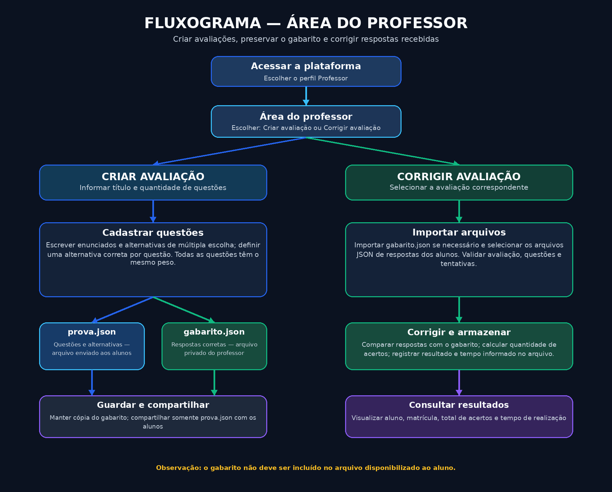
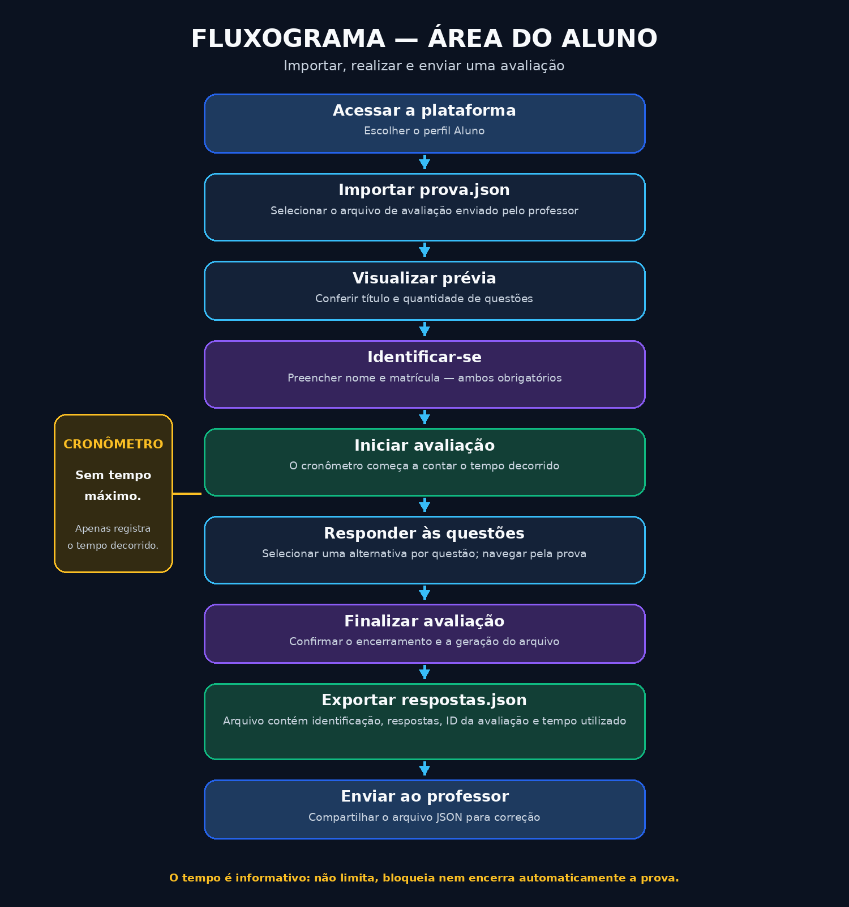

# >_ Plataforma de Avaliações Acadêmicas

> Um MVP web para criação, aplicação e correção de avaliações acadêmicas.


---

## > Sobre o projeto

A **Plataforma de Avaliações Acadêmicas** é um projeto de extensão que propõe uma aplicação web simples para auxiliar professores na criação e correção de provas e alunos na realização dessas avaliações.

O sistema possui dois ambientes principais:

- **Professor:** responsável por criar avaliações, cadastrar questões, definir o gabarito, exportar os arquivos e corrigir as respostas dos alunos.
- **Aluno:** responsável por importar a avaliação, informar seus dados, responder às questões e exportar suas respostas para envio ao professor.

Este projeto está sendo desenvolvido como um **MVP (Minimum Viable Product — Produto Mínimo Viável)**. Isso significa que sua primeira versão terá apenas as funcionalidades essenciais para validar a ideia e demonstrar o funcionamento do sistema.

O objetivo é construir uma solução funcional, simples e organizada, que possa ser aprimorada futuramente.

## > Objetivos do projeto

- Facilitar a criação de avaliações acadêmicas.
- Simplificar o compartilhamento de provas entre professores e alunos.
- Automatizar a correção de questões de múltipla escolha.
- Registrar os resultados das avaliações.
- Desenvolver uma aplicação web utilizando tecnologias fundamentais do desenvolvimento frontend.
- Construir uma base que permita futuras evoluções do sistema.

---

## > Funcionalidades do MVP

### Área do professor

- Criar avaliações com título e questões.
- Definir a quantidade de questões.
- Cadastrar enunciados e alternativas.
- Definir uma alternativa correta para cada questão.
- Considerar todas as questões com o mesmo peso.
- Exportar a avaliação em arquivo JSON.
- Exportar o gabarito em um arquivo JSON separado.
- Importar arquivos JSON com as respostas dos alunos.
- Realizar a correção automática das respostas.
- Armazenar os resultados localmente.
- Consultar os resultados dos alunos, incluindo quantidade de acertos e tempo de realização informado.

### Área do aluno

- Importar uma avaliação por meio de arquivo JSON.
- Visualizar uma prévia da avaliação.
- Consultar o título e a quantidade de questões.
- Informar nome e matrícula.
- Responder às questões de múltipla escolha.
- Utilizar um cronômetro durante a realização da prova.
- Finalizar a avaliação.
- Exportar um arquivo JSON contendo suas respostas e informações da tentativa.

### > Regra do cronômetro

O professor **não define um tempo máximo para a avaliação**.

O cronômetro possui apenas a função de registrar quanto tempo o aluno levou para realizar a prova.

- Começa a contar quando o aluno inicia a avaliação.
- Permanece ativo durante a realização.
- Não possui limite máximo.
- Não encerra a prova automaticamente.
- O tempo utilizado é registrado no arquivo JSON exportado pelo aluno.

---

## > Fluxo do sistema

### Fluxograma do professor

O professor pode criar uma nova avaliação ou corrigir uma avaliação já realizada.



### Fluxograma do aluno

O aluno importa a avaliação, informa seus dados, realiza a prova e exporta suas respostas.



---

## > Estrutura dos arquivos JSON

A comunicação entre professor e aluno será realizada por meio de arquivos JSON.

O sistema utilizará três tipos principais de arquivos.

### 1. prova.json

Arquivo exportado pelo professor e disponibilizado aos alunos.

Contém:
- Identificador da avaliação.
- Título da avaliação.
- Questões.
- Enunciados.
- Alternativas disponíveis.

**Importante:** o arquivo da prova não contém o gabarito.

Exemplo:

```json
{
  "tipo": "avaliacao",
  "versao": 1,
  "id": "AV001",
  "titulo": "Avaliação de exemplo",
  "questoes": [
    {
      "id": "Q001",
      "enunciado": "Qual alternativa está correta?",
      "alternativas": [
        {
          "id": "A",
          "texto": "Alternativa A"
        },
        {
          "id": "B",
          "texto": "Alternativa B"
        },
        {
          "id": "C",
          "texto": "Alternativa C"
        }
      ]
    }
  ]
}
```

### 2. gabarito.json

Arquivo privado do professor, contendo as respostas corretas de cada questão.

Ele será utilizado posteriormente para realizar a correção automática.

Exemplo:

```json
{
  "tipo": "gabarito",
  "versao": 1,
  "avaliacaoId": "AV001",
  "respostas": [
    {
      "questaoId": "Q001",
      "alternativaCorreta": "B"
    }
  ]
}
```

O professor deverá manter uma cópia de segurança desse arquivo.

Caso os dados do navegador sejam apagados ou a correção seja realizada em outro dispositivo, será necessário importar novamente o gabarito.

### 3. respostas.json

Arquivo gerado pelo aluno ao finalizar a avaliação.

Contém:
- Identificador da avaliação.
- Identificador da tentativa.
- Nome do aluno.
- Matrícula.
- Respostas selecionadas.
- Tempo utilizado.
- Data de realização.

Exemplo:

```json
{
  "tipo": "respostas",
  "versao": 1,
  "avaliacaoId": "AV001",
  "tentativaId": "ATT001",
  "aluno": {
    "nome": "Nome do aluno",
    "matricula": "2026001"
  },
  "respostas": [
    {
      "questaoId": "Q001",
      "alternativaSelecionada": "B"
    }
  ],
  "tempoUtilizado": 532,
  "dataRealizacao": "2026-11-08T14:30:00"
}
```

O campo `tempoUtilizado` será armazenado em segundos.

O arquivo não deverá conter o gabarito nem informações sobre a correção.

---

## > Regras de negócio

1. As questões serão exclusivamente de múltipla escolha.
2. Cada questão terá uma única alternativa correta.
3. Todas as questões terão o mesmo peso.
4. O resultado principal será apresentado pela quantidade total de acertos.
5. Questões não respondidas serão consideradas como não acertadas.
6. Nome e matrícula serão obrigatórios para iniciar a avaliação.
7. O cronômetro registrará o tempo decorrido, sem limite máximo.
8. O gabarito será armazenado separadamente da avaliação disponibilizada aos alunos.
9. A correção deverá verificar se o arquivo de respostas corresponde à avaliação selecionada.
10. O sistema deverá validar os arquivos JSON importados.
11. O sistema deverá evitar o processamento duplicado de uma mesma tentativa.

---

## > Tecnologias utilizadas

O MVP será desenvolvido utilizando tecnologias fundamentais do desenvolvimento web.

| Tecnologia | Aplicação |
|---|---|
| HTML5 | Estrutura das páginas |
| CSS3 | Estilização e responsividade |
| JavaScript ES6+ | Lógica e funcionalidades |
| LocalStorage | Armazenamento local dos dados |
| JSON | Importação e exportação de informações |

Nesta primeira versão, não serão utilizados frameworks, backend ou banco de dados.

---

## > Estrutura do projeto

```text
plataforma-avaliacoes-academicas/
│
├── index.html
├── README.md
├── .gitignore
│
├── src/
│   ├── pages/
│   │   ├── professor.html
│   │   ├── criar-avaliacao.html
│   │   ├── corrigir-avaliacao.html
│   │   ├── resultados.html
│   │   ├── aluno.html
│   │   └── realizar-avaliacao.html
│   │
│   ├── css/
│   │   ├── global.css
│   │   ├── layout.css
│   │   ├── components.css
│   │   ├── professor.css
│   │   └── aluno.css
│   │
│   ├── js/
│   │   ├── main.js
│   │   │
│   │   ├── professor/
│   │   │   ├── avaliacao.js
│   │   │   ├── questoes.js
│   │   │   ├── gabarito.js
│   │   │   ├── importar-respostas.js
│   │   │   └── resultados.js
│   │   │
│   │   ├── aluno/
│   │   │   ├── importar-avaliacao.js
│   │   │   ├── identificacao.js
│   │   │   ├── prova.js
│   │   │   ├── cronometro.js
│   │   │   └── exportar-respostas.js
│   │   │
│   │   ├── services/
│   │   │   ├── storage.js
│   │   │   ├── json.js
│   │   │   ├── correcao.js
│   │   │   └── validacao.js
│   │   │
│   │   └── utils/
│   │       ├── formatacao.js
│   │       └── identificadores.js
│   │
│   └── assets/
│       ├── images/
│       └── icons/
│
├── data/
│   └── examples/
│
└── docs/
    ├── images/
    │   ├── fluxograma-professor.png
    │   └── fluxograma-aluno.png
    ├── escopo.md
    ├── requisitos.md
    ├── fluxo-professor.md
    ├── fluxo-aluno.md
    ├── estrutura-json.md
    └── testes.md
```

---

## > Limitações do MVP

Por se tratar de uma primeira versão, o projeto possui limitações que precisam ser consideradas.

### 1. Ausência de backend

Toda a lógica será executada no navegador. Não haverá comunicação com um servidor.

### 2. Ausência de banco de dados

Os dados serão armazenados utilizando LocalStorage, ficando vinculados ao navegador e dispositivo em que foram criados.

### 3. Ausência de autenticação

O sistema não contará com cadastro de usuários, senhas ou autenticação de professores e alunos.

### 4. Compartilhamento manual

A transferência de avaliações e respostas será feita por arquivos JSON. O sistema não terá envio automático ou armazenamento centralizado.

### 5. Integridade das avaliações

Como os arquivos JSON podem ser editados, não será possível garantir que as respostas ou o tempo informado pelo aluno sejam invioláveis.

A separação do gabarito evita sua exposição direta no arquivo da prova, mas não garante segurança contra fraudes.

### 6. Tipos de questões

O MVP aceitará somente questões de múltipla escolha.

### 7. Correção simples

O resultado principal será a quantidade total de acertos, sem relatórios avançados ou pontuação individual configurável.

### 8. Cronômetro informativo

Não haverá tempo máximo para a prova. O cronômetro apenas registrará o tempo decorrido no navegador do aluno.

Essas limitações fazem parte das decisões de escopo do MVP e poderão ser revistas em versões futuras.

---

## > Como executar o projeto

1. Clone o repositório:

```bash
git clone URL_DO_REPOSITORIO
```

2. Entre na pasta:

```bash
cd plataforma-avaliacoes-academicas
```

3. Abra o projeto no editor de código.

4. Execute o arquivo `index.html` no navegador ou utilize uma extensão como **Live Server** para iniciar um servidor local.

---

## > Planejamento e organização

O desenvolvimento será organizado em um cronograma de 22 dias.

A prioridade é entregar o fluxo principal funcional até o dia 18, reservando os últimos dias para testes, documentação e ajustes.

Para consultar a divisão de tarefas, entregas e critérios de conclusão, acesse:

[`PLANO_DE_TRABALHO.md`](PLANO_DE_TRABALHO.md)

---

## > Possíveis evoluções futuras

Após a validação do MVP, o projeto poderá evoluir para uma arquitetura mais robusta, incluindo:

- Backend desenvolvido em Java com Spring Boot.
- Banco de dados PostgreSQL.
- Autenticação de professores e alunos.
- Armazenamento centralizado de avaliações e resultados.
- Controle de permissões.
- Relatórios mais completos.
- Histórico de avaliações.
- Recursos adicionais de integridade e segurança.

Essas funcionalidades não fazem parte do escopo atual.

---

## > Considerações finais

A Plataforma de Avaliações Acadêmicas busca demonstrar como tecnologias web podem ser utilizadas para simplificar processos do ambiente educacional.

Mais do que desenvolver uma aplicação completa, a proposta deste MVP é construir uma solução pequena, funcional e testável, permitindo que a equipe aplique conceitos de desenvolvimento web, lógica de programação, manipulação de arquivos e organização de software.

**Primeiro, construir. Depois, validar. Por fim, evoluir.**

---

> Projeto de extensão — Plataforma de Avaliações Acadêmicas.
